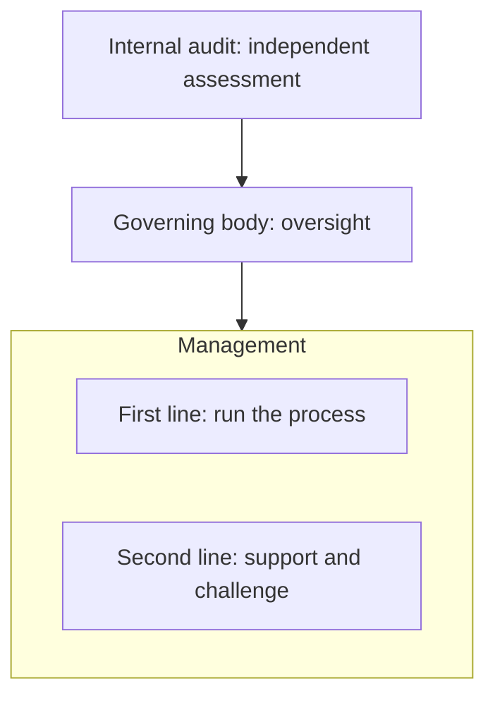

# Week 1: How corporate compliance works inside a company

[Read the companion PDF](Week_1_Compliance_Foundations_EN_HU.pdf). Printed-page references below refer to that PDF.

*A founder's first chapter*

Governance. Compliance. Assurance. These words become useful when you can connect each one to a decision, a person, and a piece of work. This chapter teaches that connection in plain English, with Hungarian explanations and one fictional company throughout.

> **THE QUESTION TO KEEP ASKING**
>
> Which requirement applies, who must do something about it, and how would we know that it happened?

By the end, you should be able to follow a conversation between a business manager, a compliance officer, and an auditor. You should also recognize where software could help them and which decisions still need a named owner.

Read the main chapter first. Use the two-page English-Hungarian glossary when a term is unfamiliar. Finish with the company-mapping exercise and the short-answer scenarios. Answers and worked examples are included.

Allow about 60-75 minutes for the chapter and reflection, then use the five-hour study schedule later in the chapter. The material is mainly English so you learn the vocabulary buyers use. Hungarian phrases explain the meaning rather than prescribe official translations.

Prepared for Balázs Faragó | 22 October 2026. Original teaching text and fictional scenarios, informed by the DOJ, IIA, and ISO readings recommended in your learning plan. Source notes and clickable reading links appear at the end.

### Chapter map

- [Core vocabulary | pp. 3-8](#governance)
- [Business scope | p. 9](#scope)
- [People and roles | pp. 10-12](#people)
- [The program | pp. 13-16](#program)
- [Worked cases | pp. 17-18](#worked-payment)
- [Practice | pp. 21-24](#study-plan)
- [EN-HU glossary | pp. 25-26](#glossary-a)
- [Original readings | pp. 27-28](#core-sources)

## Who approved this payment?

Imagine DunaWorks Group, a fictional company with 2,000 employees. It sells industrial equipment and subscription software. Its headquarters are in Hungary, with operations in Germany and the United States. It works with distributors, uses cloud suppliers, and sometimes sells to public-sector customers.

On Friday afternoon, a salesperson requests a EUR 40,000 payment to a new intermediary. The intermediary promises to help close a large contract. The invoice says only "market support." Finance cannot find an approved contract or a completed background review. The sales director says the payment is urgent.

Several questions now overlap. Does the intermediary provide a legitimate service? Is the payment allowed? Who can approve it? What information is missing? Can a senior manager bypass the review? Who gets told if someone tries?

DunaWorks has a fictional internal policy requiring intermediary review before the first payment. The amount and rule are teaching examples, not universal legal thresholds. Legal specialists would separately assess the actual transaction and applicable law.

> **MAGYARUL**
>
> A compliance itt az, hogy a szabályos üzletmenethez legyenek működő lépések: tudjuk, mit kell ellenőrizni, ki dönthet, és hol marad nyoma a döntésnek.

Keep this payment in mind. Governance determines decision authority. Risk management examines what might go wrong. Compliance addresses applicable requirements. Controls shape the payment process. Assurance helps others judge whether that process works.

## Governance: who directs and oversees?

**GOVERNANCE** - *vállalatirányítás; irányítási és felügyeleti rendszer*

The arrangements through which an organization is directed, overseen, and held accountable. For a company, think about decision rights, reporting, supervision, and consequences. [S4](#source-s4)

At DunaWorks, the board asks management to grow the business while maintaining defined standards of conduct. It expects regular reporting on serious problems. It approves suitable oversight arrangements and makes sure management has the authority and resources to act.

Management then turns direction into daily operations: hiring staff, setting approval limits, running finance systems, and deciding how supplier review will work. A CEO and other executives are part of management; the board is the governing body in this simplified example. Actual corporate structures differ.

| Question | DunaWorks example |
| --- | --- |
| Governance | Who may authorize an exception, and which serious issues must reach the board? |
| Management | How many reviewers do we need, and how will they handle the queue? |
| Operations | Has this particular intermediary supplied its contract and ownership details? |

An oversight committee is a smaller group assigned to examine a subject, such as audit or risk. Delegating detailed work does not make the wider oversight responsibility disappear. Stakeholders are people or groups with an interest in the company: employees, customers, owners, suppliers, and others.

> **PICTURE IT**
>
> Governance is deciding who can set the house rules and who must answer for the result. Management organizes the household. Operations does today's work.

Founder question: if your product finds a serious issue, who has authority to act on it, and who must receive the report?

## Risk: uncertainty about an objective

**RISK** - *kockázat*

For this chapter, risk is uncertainty that could affect an objective. Describe an event and its consequences, rather than writing a vague label such as "supplier risk." [S5](#source-s5)

DunaWorks wants to win legitimate business and pay only for legitimate services. A useful risk statement is: "A salesperson could use an intermediary invoice to route an improper payment, causing legal, financial, and reputational harm." The objective, possible event, and consequences are visible.

Likelihood means how plausible an event is. Impact means how serious its consequences could be. A risk assessment records a reasoned view of those factors and the available information. A red-yellow-green score helps prioritization, but does not replace the explanation behind it.

| Term | Meaning in our example |
| --- | --- |
| Inherent risk | The exposure imagined before considering the relevant controls: staff can request intermediary payments. |
| Residual risk | The exposure remaining after considering reviews and payment checks: reviewers may still miss deception. |
| Risk appetite | The amount and type of exposure decision-makers are willing to take when pursuing objectives. |

Risk management means identifying uncertainty, deciding how to respond, assigning actions, and checking the result. DunaWorks might improve review, avoid a transaction, obtain more information, or accept a permitted remaining business exposure through the right authority.

> **IMPORTANT DISTINCTION**
>
> Risk appetite does not authorize prohibited conduct. "We accept some uncertainty about a new market" is different from giving staff permission to ignore a mandatory requirement.

Magyarul: nem az a jó kockázatleírás, hogy "baj lehet", hanem hogy mi történhet, miért, és annak mi lenne a következménye.

## Compliance: meeting the requirements

**COMPLIANCE** - *megfelelőség; szabályoknak és kötelezettségeknek való megfelelés*

The condition and ongoing work of meeting requirements that apply to an organization. A requirement may originate in law, regulation, a contract, or a commitment the company has adopted.

An obligation is something the organization is required or has committed to do. Applicability is the question of whether that obligation covers this entity, activity, relationship, or situation. The source matters: an internal rule and a legal duty may require different responses when breached.

| Source | Illustrative requirement |
| --- | --- |
| Law or regulation | A legal specialist identifies a relevant duty for a particular activity and jurisdiction. |
| Contract | A customer agreement requires specified incident notifications or supplier checks. |
| Internal commitment | DunaWorks requires review before paying a new intermediary. |
| Adopted standard | The company chooses a management-system standard, possibly because customers expect it. |

Ethics means considering what is right, fair, and responsible. A code of conduct explains the organization's expected behavior. Something can meet a narrow rule while still raising ethical concerns. Suppose a manager pressures a junior employee to stop asking questions: a healthy company needs a way to address that behavior, even before anyone proves a specific legal breach.

GRC stands for governance, risk, and compliance. It groups related work: directing the organization, managing uncertainty, and meeting obligations. In software, GRC often names a collection of workflow and record-keeping capabilities. A product using that label still needs a clear user and task.

> **MAGYARUL**
>
> Compliance: megfelelünk annak, ami ránk vonatkozik. Etika: vállalható-e, ahogyan cselekszünk. A kettő összefügg, de más kérdésre válaszol.

## Controls: actions that make a difference

**CONTROL** - *kontroll; kockázatot kezelő intézkedés*

A measure intended to help achieve an objective or reduce a risk. It can be a human action, a system rule, a review, or a combination. The word is broader than checking something after the event.

DunaWorks configures its finance system to block the first payment to an intermediary until a designated reviewer has approved onboarding. The review and the payment block are related controls. A monthly search for payments made without approval is another control.

| Vocabulary | Concrete example |
| --- | --- |
| Preventive control | The system blocks the payment before money leaves. |
| Detective control | A later report identifies payments that bypassed approval. |
| Manual control | A reviewer examines the contract and questions the business purpose. |
| Automated control | A system compares approval status with the payment request. |

A policy states the rule or expectation: "Intermediaries need approval before payment." A procedure explains the steps: submit the form, attach the contract, route to the reviewer, and record the decision. A control is the risk-reducing measure within that process. One policy can require several procedures and controls.

Design asks whether the measure is suitable for its purpose. Operation asks whether it actually happened as required. The payment block may be well designed but disabled in one subsidiary. Alternatively, it may run perfectly while allowing the requester to approve their own request.

> **DEVELOPER TRANSLATION**
>
> A policy resembles a requirement. A procedure resembles a runbook. A control is a safeguard built into the real process. Logs and review records help show how it ran.

Week 2 will examine control testing in more detail. For now, be able to describe a control with an owner, trigger or frequency, and expected evidence.

## Evidence: what supports the claim?

**EVIDENCE** - *bizonyíték; a megállapítást alátámasztó adat vagy dokumentum*

Information that supports a conclusion. Useful evidence is relevant to the actual question and has an understandable origin, scope, and time period.

The claim is: "Every new intermediary paid during September had approval before payment." An approved onboarding record supports one part of that claim. The complete payment population tells you which intermediaries must be checked. The timestamps establish sequence. System configuration helps explain whether the block existed.

Provenance means where information came from and what happened to it. A finance export directly obtained from a named system, with a collection time and defined filters, has a clearer provenance than a spreadsheet someone forwarded without explanation.

| Evidence question | Why it matters |
| --- | --- |
| Relevant? | A training certificate does not establish that a payment was approved. |
| Complete? | Records for 18 intermediaries leave a gap if 25 were paid. |
| Timely? | Approval after payment fails a rule requiring prior approval. |
| Traceable? | You need to connect the approval to the correct entity and transaction. |
| Reliable? | An unexplained edit can change what a record means. |

Scope is the boundary of a statement or review: entities, systems, processes, locations, and periods. An audit trail records meaningful actions and decisions over time. An attestation is a stated assertion, such as a manager confirming a review; the strength and formal meaning depend on context.

> **MAGYARUL**
>
> "Megvan a dokumentum" még csak azt mondja, hogy létezik egy fájl. A kérdés az, hogy az adott állítást tényleg alátámasztja-e, a megfelelő időszakra és teljes körre.

Founder implication: evidence collection, evidence quality, and the final judgment are three separate parts of a workflow.

## Assurance: justified confidence

**ASSURANCE** - *bizonyosságot nyújtó értékelés; megalapozott bizalom*

A conclusion intended to increase confidence in something, based on an assessment against stated criteria. In everyday terms: someone has done enough defined checking to support a bounded conclusion.

DunaWorks' finance manager says all intermediary payments were reviewed. That is a management assertion. An evaluator asks for the payment population, approval records, and timing information, performs defined checks, and reports a conclusion with its scope and limitations. The extra confidence comes from the assessment and supporting work.

An audit is a structured examination. Internal audit is a function that provides independent assessment and advice within the organization. External auditors or other assurance providers come from outside. The engagement determines what they examine: a financial-statement audit does not automatically examine every compliance process.

Monitoring is ongoing observation, such as a daily report of unapproved payments. Testing examines a control against a method and criteria. Assurance is the confidence supported by the resulting assessment. These words describe related activities, not interchangeable outputs.

> **WHY INDEPENDENCE MATTERS**
>
> Imagine you wrote the payment process, approved its exceptions, and then issued the only assessment of whether it worked. A reviewer free from those management responsibilities can challenge assumptions you helped create.

Assurance always needs boundaries. A report might cover one subsidiary and one quarter. It might use a sample. It might identify missing records. Its conclusion should match the work performed. Absolute certainty about every event is rarely what the engagement can establish.

Magyarul: assurance nem biztosítás, és nem egy általános garancia arra, hogy minden rendben van. A lényeg: meghatározott szempontok alapján, meghatározott körben alátámasztott következtetés.

## What applies to this company?

A multinational is a group of activities and legal entities. A legal entity is a legally recognized organization, such as a subsidiary company. DunaWorks' Hungarian parent and US subsidiary can have different roles, contracts, data, and obligations. A group policy can set a common baseline while local requirements still need attention.

Build a business map before collecting a list of regulations. Ask what the company sells, where it operates, whom it deals with, what data it handles, and what it promises. Identify the relevant specialists when applicability is uncertain.

| Dimension | DunaWorks question |
| --- | --- |
| Activities | Selling equipment, hosting software, arranging financing, or performing regulated services? |
| Entities and places | Which subsidiary performs the activity, and where are the people and operations? |
| Counterparties | Customers, public bodies, distributors, suppliers, and business partners? |
| Data and systems | Whose data, what purpose, which systems, and which suppliers? |
| Commitments | What contracts, policies, or standards has the company adopted? |

An obligation register is a maintained record of relevant requirements, their sources, scope, and owners. It should preserve the interpretation: why someone concluded a requirement applies and what remains uncertain. A list of law names is an incomplete starting point.

> **APPLICABILITY EXAMPLE**
>
> "We operate in Europe" is too broad to identify every duty. "Our German subsidiary hosts customer employee data using this cloud supplier" gives privacy and technology specialists a concrete activity to assess.

Your Week 1 job is to ask the right scoping questions. Detailed legal interpretation belongs to the relevant domain and jurisdiction.

## Who does what?

Job titles are clues, not a reliable ownership map. The same title can cover different work in different companies. The assignments below are illustrative for DunaWorks; ask about actual decision rights and outputs when interviewing a buyer.

| Role | Practical meaning |
| --- | --- |
| Board / governing body | Oversees direction and accountability. Magyarul: a legfőbb irányító testület; often an igazgatóság in this simplified model. |
| CEO / executives | Run the company and allocate operational resources. CEO: chief executive officer, vezérigazgató. |
| Business or process owner | Answers for a business activity and its process. Example: the finance director owns payment operations. |
| CCO / compliance team | CCO: chief compliance officer, megfelelőségi vezető. Coordinates relevant compliance expertise, oversight, and challenge. |
| Legal / general counsel | Lawyers advise on legal questions. General counsel: the senior legal leader, vezető jogtanácsos or jogi vezető. |
| CRO / risk team | CRO: chief risk officer, kockázatkezelési vezető. Helps coordinate the organization's approach to risk. |
| Internal audit / CAE | Internal audit: belső ellenőrzés. CAE: chief audit executive, the internal audit leader. |
| Domain specialists | Privacy, security, HR, trade, product, and safety specialists contribute expertise for their areas. |

A regulator is a public authority with responsibilities in a particular field. An external auditor or certification body has a different role. An assessor reviewing your process on behalf of a customer is different again. Identify who they represent and what they are authorized to conclude.

Founder question: who uses your product, who supplies its data, who approves its output, and who pays? They may be four different people.

## The Three Lines Model

The IIA separates roles by their contribution to governance and risk management. First-line management delivers activities and manages their risks. Second-line specialists provide expertise, support, monitoring, and challenge. Internal audit supplies independent assurance and advice. The governing body oversees the organization. [S2](#source-s2)

*Roles work concurrently. Reporting is simplified.*

At DunaWorks, finance processes the payment and operates its controls. Compliance helps set review expectations and challenges unresolved concerns. Internal audit later examines whether the arrangements worked across the period and scope it selected. The board receives appropriate management reporting and assurance.

The lines describe roles, rather than three mandatory departments or a three-step approval sequence. First- and second-line roles may coexist in one team. Internal audit's independence from management responsibilities remains important. External assurance providers complement the model. [S2](#source-s2)

> **MAGYARUL**
>
> Első vonal: elvégzi és kézben tartja az üzleti folyamatot. Második vonal: szakmai segítséget ad, figyel és kérdéseket tesz fel. Harmadik vonal: független belső értékelést ad.

Original DunaWorks illustration. The IIA role summary above is deliberately short; use the source for the model's full principles and qualifications.

## Responsibility, accountability, and challenge

**RESPONSIBILITY / ACCOUNTABILITY** - *feladatért való felelősség / számonkérhetőség, végső elszámolási felelősség*

Responsibility concerns doing assigned work. Accountability concerns answering for the decision or result. In everyday corporate speech these can blur, so clarify the actual authority and expectation.

A finance analyst collects payment records. The finance director remains answerable for the payment process. A compliance officer can challenge missing reviews without becoming the person who operates every finance control. A software provider can support the process while the company's designated decision-maker remains accountable for its use.

RACI is an optional way to make assignments explicit: Responsible does the work; Accountable answers for it; Consulted gives input; Informed receives updates. For the exercise, give each task one clear accountable owner. That is a simplifying design choice, not a universal law.

| Task | Does it | Answers for it |
| --- | --- | --- |
| Collect onboarding facts | Analyst | Onboarding process owner |
| Approve business purpose | Sales manager | Authorized business approver |
| Run payment checks | Finance team | Finance process owner |
| Assess process independently | Internal auditor | CAE for the audit engagement |

Challenge means asking the questions that test whether a proposed action is adequately supported. Escalation means moving an issue to someone with suitable authority or expertise. At DunaWorks, an unresolved high-risk payment goes to a designated decision-maker instead of sitting indefinitely in an analyst's inbox.

> **INDEPENDENCE IN PRACTICE**
>
> A reviewer can advise on a better process without taking over management's decisions. If your workflow makes the reviewer operate or approve the activity they later assess, inspect how independence will be maintained.

## A system of people and recurring work

**COMPLIANCE PROGRAM / MANAGEMENT SYSTEM** - *megfelelőségi program / megfelelőségi irányítási rendszer*

An organized way to identify obligations, assign work, support people, check results, and improve. A management system includes roles, routines, decisions, and information; it can use several software tools.

ISO 37301 is a compliance management-system standard applicable across many kinds of organizations. Its public overview describes establishing, operating, evaluating, maintaining, and improving the system. The full standard is paid; the public overview and FAQ are the ISO material used here. [S3](#source-s3)

> **THE DOJ'S THREE QUESTIONS, PARAPHRASED**
>
> Is the program suitably designed? Does it have the resources and authority to function? Does it work in actual practice? This is US prosecutorial evaluation guidance, not a universal certification checklist. [S1](#source-s1)

Use those questions on our fictional payment. A well-designed process defines the review and prevents obvious bypasses. A workable process has trained reviewers, system access, and an escalation route. An effective process produces timely, justified decisions and learns from failures.

DunaWorks can organize recurring work into a practical loop: understand business activities and requirements; assess the main risks; define expectations and controls; communicate and operate them; monitor and examine results; investigate concerns; fix weaknesses; report and revise.

A framework is an organizing structure for thinking or working. A program is the company's operating arrangement. A tool supports pieces of that arrangement. For example, an approval application may handle one control while the wider program also needs leadership, training, reporting, and review.

The loop and payment examples are original teaching aids, rather than a reproduction of either source's detailed requirements.

## Law, standards, policies, and certificates

These labels describe different sources of expectations and different outputs. Record the source and scope when a customer says they "need to be compliant." Ask which specific requirement or assurance result is driving the work.

| Label | Plain-English explanation |
| --- | --- |
| Law / regulation | A legal source. Ask which authority issued it and which activities and entities it covers. |
| Guidance | An authority's or professional body's explanation or evaluation approach. Its legal significance depends on context. |
| Standard | An agreed set of requirements or recommendations. Adoption may be voluntary, contractual, or otherwise required. |
| Policy | The company's own statement of expectations. It can be stricter than an external baseline. |
| Certification | An assessment result against a specified standard and scope, issued by a certification body. |
| Audit report | A report on defined subject matter, criteria, procedures, and conclusions. |

ISO's FAQ explains that ISO develops standards while external certification bodies perform certification. It also explains that ISO 37301 is generally voluntary, although adoption can become a legal or contractual requirement in a particular context. [S6](#source-s6)

Imagine DunaWorks has a certificate covering one management system in one entity. A customer now asks about a newly acquired subsidiary. The certificate's scope must be checked. A certification and a conclusion that a particular transaction complies with every applicable law are different claims.

> **MAGYARUL**
>
> A szabvány a követelményrendszer. A tanúsítvány egy meghatározott körre vonatkozó értékelési eredmény. A belső szabályzat pedig a cég saját elvárása. Mindig kérdezd meg: mire, kire és milyen időszakra vonatkozik?

## Culture: what happens under pressure?

**CULTURE / TONE AT THE TOP** - *szervezeti kultúra / a felső vezetés példamutatása*

Culture is the behavior people learn is expected, tolerated, and rewarded. Tone at the top describes the example and messages set by senior leaders; line managers translate them into everyday choices.

The FRC connects corporate culture with purpose, values, strategy, and leadership oversight. Use that idea to examine what a company actually rewards, rather than judging its culture from a code of conduct alone. [S7](#source-s7)

At DunaWorks, the CEO says intermediary checks matter. But the sales director promotes the person who bypassed review to close a deal and criticizes the colleague who raised concerns. Staff learn from those consequences. An online training module cannot by itself resolve that conflict.

Now imagine the manager pauses the transaction, explains the missing information, supports the person who asked questions, and gives reviewers enough time to finish. The company's stated expectation becomes visible in an actual decision.

An incentive is something that encourages behavior, such as a bonus, recognition, or promotion criterion. Consequence management means responding consistently when expectations are met or breached. Consider who is rewarded, who is disciplined, and whether senior people receive special treatment.

Training helps people perform their role. For the salesperson, a short intermediary scenario and clear escalation contact may be more useful than a long list of law names. Completion rate shows attendance; a scenario response, observed behavior, and follow-up questions provide different information about understanding.

> **FOUNDER EXERCISE**
>
> Suppose your product raises a useful alert and the business manager suppresses it. Identify the decision authority, escalation route, and record needed for the workflow to have an effect.

## Speak up, investigate, and improve

**SPEAK-UP / WHISTLEBLOWING CHANNEL** - *bejelentési csatorna; visszaélés-bejelentési rendszer*

A route through which people can raise concerns about suspected wrongdoing. A report starts a process of assessment; it does not establish that the allegation is true.

At DunaWorks, an employee reports that a manager instructed them to approve the intermediary without review. Case intake records what was reported. Triage decides how urgently it needs attention and who should handle it. An investigation gathers and evaluates relevant information to establish what happened.

Confidential means information is restricted to appropriate recipients. Anonymous means the reporter's identity has not been supplied or established in that channel. A company should understand the real limits of its arrangements before making promises about either.

Retaliation is adverse treatment because someone raised a concern or participated in a protected process. In the fictional company, removing an employee from good assignments because they reported the payment would require attention. The applicable protections and procedures depend on the relevant rules.

A finding is an assessed weakness or problem, supported by the work performed. Remediation is the work to address it. Root-cause analysis asks why it happened: perhaps the approval block was absent from an acquired subsidiary, or staff could create duplicate supplier records.

Correcting one record resolves that instance. Changing the process and checking that the change works addresses the underlying weakness. Closure should have an explicit basis: who checked what, with which evidence, and when.

> **MAGYARUL**
>
> Bejelentés: valaki jelzi a gyanút. Vizsgálat: utánajárunk. Megállapítás: mit támasztanak alá az adatok. Javítás: mit változtatunk. Visszaellenőrzés: valóban működik-e a változtatás.

## The payment, from request to closure

Continue the fictional DunaWorks case. The internal rule requires intermediary approval before first payment. Our initial problem is missing information. The facts do not yet establish bribery or any other legal violation.

| Stage | Action and resulting record |
| --- | --- |
| 1. Intake | Finance records the request, entity, intermediary, amount, business sponsor, and missing contract. |
| 2. Review | A reviewer examines the proposed service and supporting information, then records unresolved questions. |
| 3. Decision | The authorized decision-maker keeps payment on hold while questions remain. The reason is documented. |
| 4. Escalation | Sales pressure to bypass review is referred through the defined route. The pressure and response are recorded. |
| 5. Investigation | The concern is assessed by suitable personnel. They distinguish established facts from allegations. |
| 6. Remediation | Management fixes an identified bypass in the supplier-creation process and assigns an owner and date. |
| 7. Verification | A reviewer checks the change using a defined method. The finding closes only on an adequate basis. |

The owner of a commercial relationship, a transaction approver, a compliance adviser, and an independent evaluator contribute different things. A request moving through all their inboxes does not by itself show that each person's required task was completed.

> **WHAT SOFTWARE COULD SUPPORT**
>
> Collect required information, preserve identities and timestamps, route work, flag missing evidence, track decisions, and follow remediation. A proposed decision still needs the authority and criteria assigned by the company.

All steps, thresholds, and assignments in this case are fictional. Their purpose is to make the vocabulary concrete.

## The same logic in a technical workflow

DunaWorks has another fictional policy: remove a departing employee's access to three named critical systems within 24 hours of effective departure. This is a company teaching rule, not a general legal deadline.

| Concept | What it looks like here |
| --- | --- |
| Objective | Former staff should no longer have inappropriate access. |
| Risk | A usable account remains after departure and is misused. |
| Control | HR triggers offboarding; IT disables access and checks exceptions. |
| Evidence | Departure timestamp, identity match, system logs, and any approved exception. |
| Monitoring | A daily comparison flags unmatched departures or active accounts. |
| Assurance question | Did the process meet its criteria across the defined systems and period? |

An identity provider is a system that manages identities and often access to applications. Its log might show one account was disabled, but the company still needs to understand which applications that action affected. A separate application account can remain active outside that scope.

Suppose a record is missing. That supports a conclusion that evidence is incomplete; it does not automatically establish whether access stayed active. A good workflow preserves that uncertainty and assigns follow-up. It also distinguishes a late action from an action whose timing cannot be established.

> **WHY THIS MATTERS TO A DEVELOPER**
>
> A useful compliance feature often connects business events with system events, preserves a reviewable history, and sends unresolved cases to an owner. Understanding the operational boundary comes before implementing the check.

You will explore populations, sampling, and control testing in Week 2. This case introduces the questions without assuming those methods.

## A normal week, behind the terminology

Here is a fictional week for DunaWorks' compliance manager. It illustrates why the work involves both judgment and coordination.

| Day | Work and output |
| --- | --- |
| Monday | Review new intermediary requests. Ask sales for missing business-purpose information. |
| Tuesday | Discuss a reported concern with the appropriate investigation team. Agree next actions and access to the case. |
| Wednesday | Review a proposed contract requirement with legal and operations. Identify the owner and implementation work. |
| Thursday | Follow up overdue remediation. Check whether the new evidence actually supports closure. |
| Friday | Prepare a management report: significant issues, unresolved decisions, trends, and action owners. |

The records may live in a case-management system, documents, email, tickets, and spreadsheets. A case is a bounded item requiring handling, such as one report or supplier review. A workflow is the sequence of tasks, decisions, and handoffs used to handle it. A register is a maintained inventory, such as a list of obligations or conflicts.

A dashboard summarizes information for an audience. A useful management dashboard might show serious overdue issues, their age, responsible owners, and needed decisions. An overall green percentage can hide a single important exception if its meaning is unclear.

> **WHAT TO ASK IN AN INTERVIEW**
>
> "Show me the last request you finished. What started it? What information did you chase? Who decided? What record showed it was complete?" A concrete walkthrough reveals more than asking whether someone wants automation.

## Where a product might help

Look for a repeated task with a clear user, inputs, decisions, and accepted output. The examples below are product hypotheses to investigate, rather than claims that a market gap has been proven.

| Observed friction | A bounded product hypothesis |
| --- | --- |
| Missing information | Check a specific request for required facts and prepare targeted follow-up. |
| Unusable evidence | Flag missing dates, unclear scope, unmatched identities, or absent approvals. |
| Unclear ownership | Route unresolved items to the appropriate owner and preserve the decision history. |
| Repeated reporting | Prepare a source-linked issue summary for a defined management audience. |
| Weak closure | Collect remediation evidence and make the required verification explicit. |

A buyer is the person or organization authorizing purchase. A user does the work. A reviewer decides whether the output is adequate. A budget owner controls the relevant spending. These roles can overlap, but assuming they are the same can hide a difficult sales or adoption problem.

For DunaWorks, an analyst may like faster supplier reviews while the compliance leader requires defensible decisions and IT evaluates data access. The value proposition needs to work for that chain of people. A small pilot can compare time spent, rework, missed issues, and reviewer acceptance against the existing process.

> **KEEP THE CLAIM PRECISE**
>
> "Prepares a reviewable evidence-gap report for this payment control" describes an assessable output. A broad claim that a tool makes a whole company compliant leaves the requirements, decisions, and boundaries undefined.

Begin discovery in Week 1. A practitioner can correct your model of the workflow before you invest in a technical solution.

## Use the five hours deliberately

| Time | Activity |
| --- | --- |
| 75 minutes | Read the chapter, pause on the examples, and answer the scenarios before checking the key. |
| 45 minutes | Read selected original sections using the source guide at the end. |
| 120 minutes | Complete the company-mapping exercise on the next page and revise it. |
| 60 minutes | Have one practitioner conversation and write your notes. Preparation and synthesis are included. |

Your exercise deliverable is a one-page operating map of DunaWorks, or a real company you know well. Add a second page only for assumptions and open questions. Start with activities and decisions; a list of regulations can come later.

Include the legal entities and locations; three important business activities; plausible obligation areas and their sources; the people who operate and review each process; one control and its evidence for each activity; and a route for serious issues.

Choose activities from different areas, such as intermediary payments, employee offboarding, and cloud-supplier onboarding. Label each statement "known," "assumed," or "needs specialist review." If you use the fictional company, legal applicability remains an exercise assumption.

> **PRACTITIONER CONVERSATION**
>
> Ask for a recent task, the information it required, a point of delay, the final decision-maker, and the record that supported completion. Use a redacted walkthrough or description; you do not need confidential company files.

Finish by explaining, in your own words, the difference between governance, risk, compliance, a control, evidence, and assurance.

## A worked company map

This is a fictional starting answer. It demonstrates structure and deliberately leaves legal applicability open. It is not an assessment of a real company.

| Activity | Expectation / owner | Control / evidence | Review / issue route |
| --- | --- | --- | --- |
| Intermediary payment | Internal prior-review rule. Finance owns payments; business owns the relationship. | Payment blocked pending approval. Contract, decision, and timestamps. | Compliance challenges unresolved concerns; a designated manager handles escalation. |
| Employee offboarding | Internal 24-hour rule for three systems. HR and IT have assigned tasks. | Disable accounts and compare departures. HR record and access logs. | Security follows unmatched cases; serious failures reach the designated owner. |
| Cloud-supplier onboarding | Contract, privacy, and security requirements to be assessed. Procurement coordinates. | Record relevant data uses and obtain approval before use. Assessment and decision. | Privacy, legal, and security specialists assess their areas; gaps receive owners. |

At the top of your map, add: Hungarian parent plus German and US operations; equipment and software sales; distributors and cloud vendors; public- and private-sector customers. Confirm the actual entity and activity before selecting requirements.

Separately show the board's oversight and internal audit's independent assessment role. A business process can have several contributors while its individual decisions and outputs still need clear ownership.

> **WHAT MAKES THE MAP USEFUL?**
>
> Someone can follow a requirement into work, identify the decision-maker, find the supporting evidence, and see what happens when the process fails.

## Eight short scenarios

Answer aloud or in a few sentences before reading the key. Explain your reasoning and any missing information. These are learning scenarios, rather than tests of detailed law.

1. The board asks to receive serious overdue findings every quarter. The compliance manager prepares the report. Which part is governance, and which part is management work?

2. DunaWorks has an excellent intermediary policy. You cannot find any review records for the last six months. What can you conclude, and what remains unknown?

3. A manager says the company has "high risk appetite," so an unapproved transaction can proceed despite a mandatory prohibition. What is wrong with the reasoning?

4. A reviewer helped advise on a process design. Later they are asked to own daily approvals and provide its independent audit conclusion. Which assignment creates a concern?

5. A dashboard is green because all requested documents were uploaded. What else would you need before concluding the control worked?

6. A certificate covers the parent company. Sales uses it to answer questions about a newly acquired subsidiary. What should be checked?

7. A hotline received no reports this year. Can you infer that misconduct is absent? What additional questions would you ask?

8. You propose automating compliance reports. Identify the user, reviewer, buyer, and an observable result a pilot should measure.

## Reasoning through the answers

1. The board's reporting expectation is an oversight arrangement. Preparing and delivering the report is assigned management work. Check who defines seriousness, who provides the data, and how urgent issues are handled between reporting dates.

2. The policy establishes intent. Evidence about actual execution is missing. Reviews may have been skipped, recorded elsewhere, or performed inadequately. Investigate the population and records before concluding which occurred.

3. An appetite for exposure does not provide authority to disregard a mandatory requirement. Establish the relevant rule and facts, then use the authorized route to address the proposed transaction.

4. Taking management responsibility for daily approval creates a concern when assessing that same activity independently. Advice alone need not amount to operating the process. Clarify responsibilities and appropriate safeguards.

5. Check whether the evidence is relevant, complete, reliable, timely, and linked to the correct scope and criteria. Upload status measures one workflow event. It does not establish the conclusion the documents are supposed to support.

6. Check the certificate's entities, activities, systems or sites, validity, and other stated boundaries. Establish the subsidiary's status and the exact customer question. Keep the answer within what the evidence supports.

7. Zero reports has several possible explanations. Ask whether people know the channel, trust it, can access it, and fear adverse treatment. Consider other indicators and how concerns are handled. The number alone cannot establish absence of misconduct.

8. One possible answer: analyst prepares; compliance leader reviews; authorized budget owner purchases. A pilot might measure preparation time, substantive corrections, and acceptance of the resulting report. Confirm the roles and baseline with a real customer.

You are ready to continue when you can explain these distinctions using a new example, and identify uncertainty without hiding it inside a confident-looking status.

## The words, without the fog

These are practical learning translations. Professional and statutory terminology can vary with the context.

| English | Hungarian | Plain-English meaning |
| --- | --- | --- |
| Accountability | számonkérhetőség, elszámolási felelősség | Who must answer for the result. |
| Applicability | alkalmazhatóság; ránk vonatkozik-e | Whether a requirement covers this activity and entity. |
| Assurance | bizonyosságot nyújtó értékelés | Confidence supported by defined assessment work. |
| Attestation | nyilatkozat, állítás igazolása | An assertion; formal meaning depends on context. |
| Audit | audit, módszeres vizsgálat | A structured examination with a defined scope. |
| Audit trail | ellenőrzési nyomvonal | A history of relevant actions and decisions. |
| Compliance | megfelelőség | Meeting applicable requirements and commitments. |
| Control | kontroll, kockázatkezelő intézkedés | A measure intended to support an objective or reduce risk. |
| Culture | szervezeti kultúra | Behavior people learn is expected and rewarded. |
| Due diligence | átvilágítás, kellő gondosság | Gathering and evaluating relevant information before or during a relationship or decision. |
| Escalation | magasabb vagy illetékes szintre emelés | Getting an issue to suitable authority or expertise. |
| Evidence | bizonyíték, alátámasztó információ | Information supporting a particular conclusion. |
| Finding | megállapítás, feltárt hiányosság | An assessed issue or weakness supported by work. |
| Governance | vállalatirányítás és felügyelet | Arrangements for directing and overseeing the company. |
| GRC | irányítás, kockázatkezelés, megfelelőség | Related fields often coordinated through shared processes. |

## The words you will hear next

| English | Hungarian | Plain-English meaning |
| --- | --- | --- |
| Inherent risk | eredendő kockázat | Exposure before considering relevant controls. |
| Internal audit | belső ellenőrzés | Independent internal assessment and advice. |
| Management system | irányítási rendszer | Roles, processes, and routines for achieving objectives. |
| Monitoring | nyomon követés, figyelemmel kísérés | Ongoing observation of performance or issues. |
| Obligation | kötelezettség | Something required or committed to. |
| Policy | szabályzat, alapelv | A stated organizational expectation. |
| Procedure | eljárásrend | Instructions for performing the work. |
| Remediation | hiányosság megszüntetése, javító intézkedés | Work to address a problem and its causes. |
| Residual risk | maradványkockázat | Exposure remaining after considering controls. |
| Risk appetite | kockázatvállalási hajlandóság | The amount and type of exposure the organization is willing to take. |
| Root cause | kiváltó vagy alapvető ok | Why the problem arose beneath the immediate symptom. |
| Scope | hatókör, vizsgált kör | The boundary of an activity, claim, or assessment. |
| Segregation of duties | feladatok és jogosultságok szétválasztása | Dividing incompatible tasks to reduce error or abuse. |
| Stakeholder | érintett, érdekelt fél | A person or group with an interest in the organization. |
| Whistleblowing | visszaélés-bejelentés | Raising a concern about suspected wrongdoing. |

Roles: CCO = chief compliance officer; CRO = chief risk officer; CAE = chief audit executive; CEO = chief executive officer. Read the actual responsibilities behind each title.

## The three recommended sources

The DOJ and IIA PDFs and the ISO public overview were fetched and reviewed for this chapter. Source editions are named below. Links open the original materials. Page references mean the printed page number, which can differ from the PDF viewer's page index.

**S1: [US Department of Justice - Evaluation of Corporate Compliance Programs](https://www.justice.gov/criminal/criminal-fraud/page/file/937501/dl)**

September 2024 edition; 25 PDF pages. Read printed pages 1-2 for the opening questions. Skim pages 11-13 on leadership, authority, and resources, then 17-21 on effectiveness, investigations, and remediation. Allow about 20 minutes. Purpose: understand a prosecutor's evaluation perspective, rather than memorize a universal checklist.

**S2: [The Institute of Internal Auditors - The IIA's Three Lines Model](https://www.theiia.org/globalassets/documents/resources/the-iias-three-lines-model-an-update-of-the-three-lines-of-defense-july-2020/three-lines-model-updated-english.pdf)**

2020 paper, updated September 2024; 14 PDF pages. Read printed pages 4-5 and 7-11 for roles, independence, and relationships. Allow about 20 minutes. Purpose: understand who does, supports, challenges, and independently assesses the work.

**S3: [ISO/TC 309 - ISO 37301 public overview](https://committee.iso.org/sites/tc309/home/projects/published/iso-37301-compliance-management.html)**

Overview of ISO 37301:2021. Read the scope and the explanation of a compliance management system. Allow about five minutes. The chapter uses this public overview and the linked public FAQ; it does not reproduce or claim to implement the full paid standard.

This chapter is original explanatory material, not an official translation or endorsement by these organizations. The Hungarian terms are learning aids. The fictional scenarios, study tasks, diagrams, and product hypotheses were created for this chapter.

## Supporting sources and your finish line

These optional sources support particular definitions and distinctions. They broaden the context; they are not extra required homework.

**S4: [Financial Reporting Council - Corporate Governance overview](https://www.frc.org.uk/library/standards-codes-policy/corporate-governance/corporate-governance-overview/)**

Supports the explanation of governance. The UK code has its own scope; the fictional company example does not imply that it applies to every company.

**S5: [HM Treasury - The Orange Book](https://www.gov.uk/government/publications/orange-book/the-orange-book-management-of-risk-principles-and-concepts)**

Online edition, reviewed 22 October 2026. Supports risk, objectives, appetite, and structured risk management. It is UK government guidance; the examples here adapt the concepts for learning.

**S6: [ISO/TC 309 - ISO 37301 FAQ](https://committee.iso.org/files/live/sites/tc309/files/FAQ%2037301/ISO%2037301%20FAQs%2C%20May%202022.pdf)**

May 2022. Questions 5-6 and 10 explain voluntary adoption, possible contractual requirements, and external certification bodies.

**S7: [Financial Reporting Council - Corporate Culture](https://www.frc.org.uk/library/standards-codes-policy/corporate-governance/corporate-culture/)**

Supports the connection between culture, leadership, values, strategy, and oversight.

> **YOUR WEEK 1 FINISH LINE**
>
> You can explain the six core terms in your own words, show who owns and reviews three company processes, connect expectations to actions and evidence, and describe one real workflow after a practitioner conversation.

Next week: examine control design, execution, evidence quality, testing, and remediation in more depth. Bring the company map and the uncertainties you recorded.
